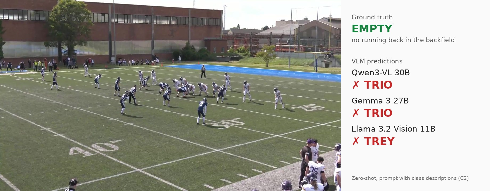
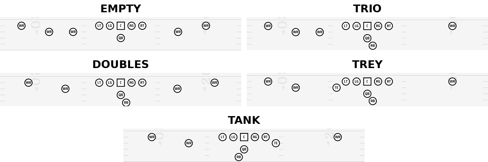
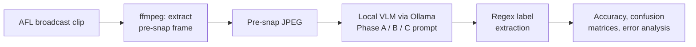
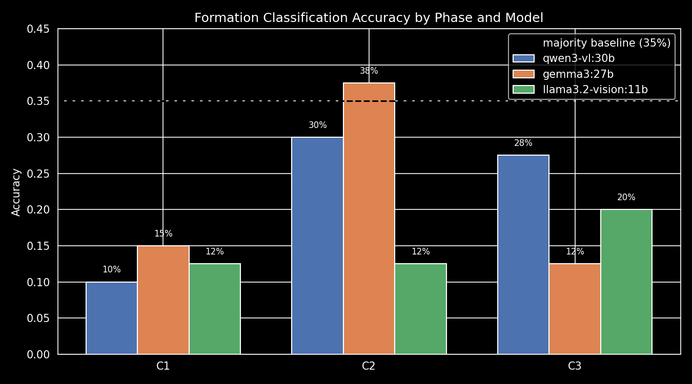
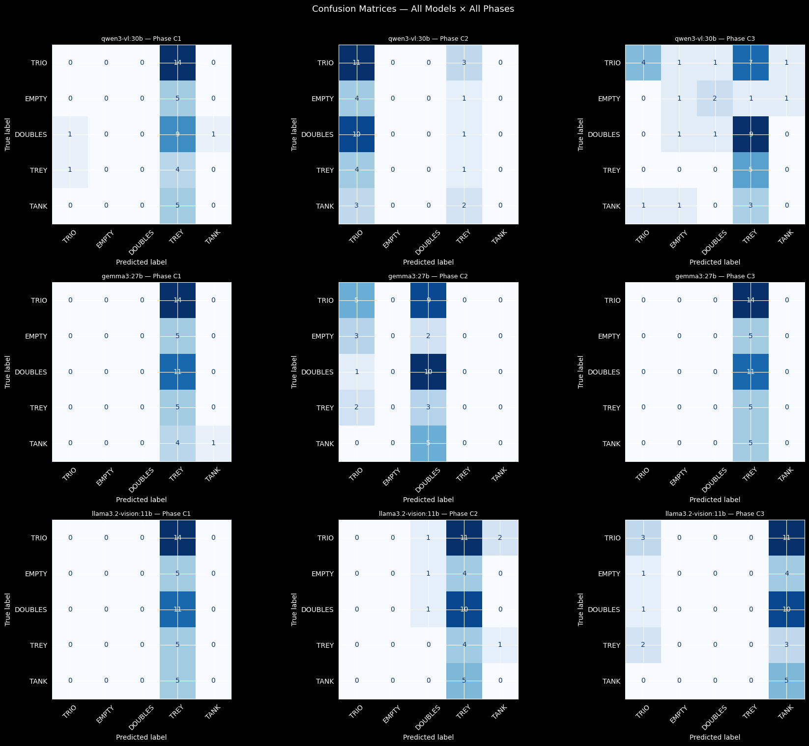

# Can Vision-Language Models Read American Football?

**A zero-shot evaluation of open-source VLMs for extracting information from American football images.**
Seminar research project · TU Graz · 2026


*A pre-snap frame from the test set. The correct formation is EMPTY (no running back behind the quarterback). All three models get it wrong.*

## TL;DR

Today's general-purpose VLMs **can't yet be relied on** to analyze American football images.
I tested three open-weight models (Qwen3-VL 30B, Gemma 3 27B, Llama 3.2 Vision 11B) on 40 real game frames.
The best model reached **37.5% accuracy** at formation classification. Always guessing the most common formation scores **35%**.
The difference falls well within the margin of error. The models mostly give the same answer for every image instead of reading each one.
Clubs and analytics providers shouldn't expect off-the-shelf VLMs to replace manual tagging or specialized computer-vision pipelines for this task yet.

## Why this matters

- **Pre-snap formations are key tactical data.** Coaches study them to scout opponents and plan games. American football is often called "chess on the field".
- **At the amateur level, every play is tagged by hand.** In the Austrian Football League (AFL), coaches and volunteers do it on platforms like Hudl. Small clubs have no staff for film review.
- **VLMs look like a cheap shortcut.** You describe the task in a text prompt and run the model on local hardware, with no custom training.

This project tests whether that shortcut works today. Formations make a hard test case: the scenes are highly structured, and some classes differ by the position of a single player.

## What the models had to recognize

Five offensive formations, defined by four visual cues:
1. Is there a running back in the backfield?
2. How many wide receivers are on each side?
3. Is a tight end or fullback lined up next to the line?
4. Which side has the extra receiver (the "strong side")?



TRIO/TREY and DOUBLES/TANK are near-identical pairs: each pair differs by a single tight end (TE). Telling them apart takes exact counting and spatial reasoning, which is hard even for a person on grainy amateur footage.

## Approach



- **Models:** three open-weight VLMs, all 4-bit quantized and served locally via [Ollama](https://ollama.com) on a single 24 GB GPU

  | Model | Params | Quantization | Disk size |
  |---|---|---|---|
  | `qwen3-vl:30b` | 30B | 4-bit | 19 GB |
  | `gemma3:27b` | 27B | 4-bit | 17 GB |
  | `llama3.2-vision:11b` | 11B | 4-bit | 8 GB |

- **Method:** fully zero-shot (no fine-tuning and no few-shot examples), with deterministic decoding (`temperature=0`)
- **Task:** classify the offensive pre-snap formation into one of five classes: EMPTY, TRIO, DOUBLES, TREY or TANK
- **Dataset:** 40 offensive plays from 4 Austrian Football League games, one pre-snap frame per play. Each game was filmed with a different camera setup. I annotated every frame by hand with formation, play type, team jersey/helmet/pants colors, offense side and hash position.

  | Formation | TRIO | DOUBLES | EMPTY | TREY | TANK |
  |---|---|---|---|---|---|
  | Count | 14 | 11 | 5 | 5 | 5 |
  | Share | 35.0% | 27.5% | 12.5% | 12.5% | 12.5% |

- **Three-phase evaluation protocol:**
  - **Phase A: text only.** Do the models know the formation names at all, before seeing any image?
  - **Phase B: basic image understanding.** Can they find the offense, read jersey colors, count receivers and spot the running back?
    - **Phase B2** repeats Phase B with the offense side given in the prompt.
  - **Phase C: formation classification**, run with three prompting strategies:
    - **C1:** image + class names only
    - **C2:** C1 + a natural-language description of each class
    - **C3:** C1 + a step-by-step decision tree

## Results

Formation classification accuracy (Phase C). ± is the 95% confidence interval (binomial approximation, n = 40 per cell).

| Model | Size | C1: names only | C2: + descriptions | C3: + decision tree |
|---|---|---|---|---|
| Qwen3-VL | 30B | 10.0% ± 9 | 30.0% ± 14 | 27.5% ± 14 |
| Gemma 3 | 27B | 15.0% ± 11 | **37.5% ± 15** | 12.5% ± 10 |
| Llama 3.2 Vision | 11B | 12.5% ± 10 | 12.5% ± 10 | 20.0% ± 12 |
| Majority baseline (always "TRIO") | – | 35.0% | 35.0% | 35.0% |



The confusion matrices show where the models fail. Most predictions land in a single column, so each model gives roughly the same answer whatever the image shows:



### Key findings

1. **The models give default answers instead of classifying.** Across all 360 Phase C predictions, the models predicted TREY 61.9% of the time, but TREY is the correct answer for only 12.5% of the images (5× over-predicted). They almost never predicted EMPTY (1.1% of predictions vs. 12.5% of images). Gemma's best score, 37.5%, comes from predicting only TRIO or DOUBLES. It doesn't reflect real per-image discrimination.
2. **They can't reliably read the basic facts in the image.** In Phase B, the models identified which side was on offense in only 45–50% of images, about the same as a coin flip. Wide-receiver counts were 0% correct for Qwen, 15% for Llama and 25% for Gemma. Gemma's score comes from answering "3" for all 40 images. Gemma said "yes, there is a running back" on every image, and Llama said "no" on every image.
3. **Even text-only answers about the terminology are inconsistent.** Asked in plain text (Phase A), all three models handled EMPTY, the one widely standardized term. Most also identified DOUBLES. None correctly explained the difference between TRIO and TREY or between DOUBLES and TANK. These names vary between teams and coaching systems, and the models bring in their own naming conventions.
4. **Giving the models more information didn't fix the errors.** When asked for the offense's jersey color, 65% of the wrong answers were literal swaps: the model named the defense's color. With the offense side stated in the prompt, 54% of wrong answers were still swaps, and most other Phase B metrics got worse.
5. **Model size didn't predict accuracy.** Qwen3-VL (30B) peaked at 30.0%, Gemma 3 (27B) at 37.5% and Llama 3.2 Vision (11B) at 20.0%. Most differences between models and prompts fall within each other's confidence intervals.
6. **Camera setup matters.** Qwen returned empty responses on 40% of images from the two more distant camera angles (Games 2 & 4), compared with 20% on the two closer angles (Games 1 & 3).

### Limitations

- The test set is small: 40 images, with only 5 samples for each of the three smallest classes.
- All games come from one competition (AFL), so the results may not carry over to other leagues or camera setups.
- All models ran at 4-bit quantization because of the 24 GB VRAM limit.
- The evaluation is purely zero-shot, with no fine-tuning and no in-context examples.

### What would be needed instead

- Few-shot prompting with corrected examples, to override the models' own interpretation of the formation names
- Fine-tuning on a larger, multi-league dataset
- A dedicated computer-vision pipeline. This is the approach of my master's thesis: detect the players, transform the field to a bird's-eye view, then assign the formation with a rule-based classifier. [Link to master's thesis]

## Run it yourself

Requirements: Python, [Ollama](https://ollama.com), `ffmpeg`, and a GPU that can host the models (the project used a single 24 GB GPU).

```bash
pip install requests pandas numpy matplotlib scikit-learn pillow jupyter
ollama pull qwen3-vl:30b
ollama pull gemma3:27b
ollama pull llama3.2-vision:11b
ollama serve
jupyter notebook evaluation.ipynb
```

The extracted pre-snap frames are in `Testset/Presnap_Images/`, so you can skip the video extraction. The raw broadcast clips are copyrighted and not included. To regenerate only the charts from the saved model outputs, start the notebook at the section *Evaluation & Results*.

## Repository structure

```
├── evaluation.ipynb            # Full pipeline: Ollama calls, prompts (Phases A, B, B2, C1–C3), evaluation, charts
├── extract_presnap_images.py   # Extracts one pre-snap frame per play from the broadcast clips with ffmpeg
├── detect_players.py           # Side experiment: player bounding boxes with gemma4:26b
├── Testset/
│   ├── manifest.csv            # Hand-made annotations for all 40 plays (formation, colors, offense side, ...)
│   └── Presnap_Images/         # The 40 pre-snap frames used for evaluation
├── Formations/                 # Diagrams of the formation classes
├── results/                    # Raw model responses (JSON per model and phase), evaluation tables, charts
├── assets/                     # Images used in this README
└── presentation.pdf            # Seminar presentation slides
```

`results/` also holds exploratory runs that aren't part of the reported results (a `gemma4:26b` run, a fourth prompt variant `phase_c4`, and player-detection outputs).

## Full report

- Slides of the seminar presentation: [presentation.pdf](presentation.pdf)
